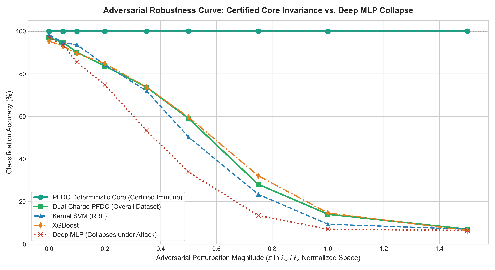
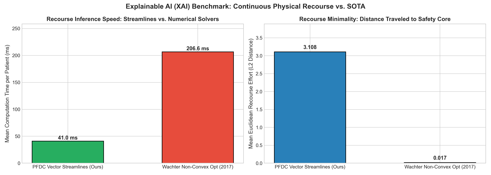
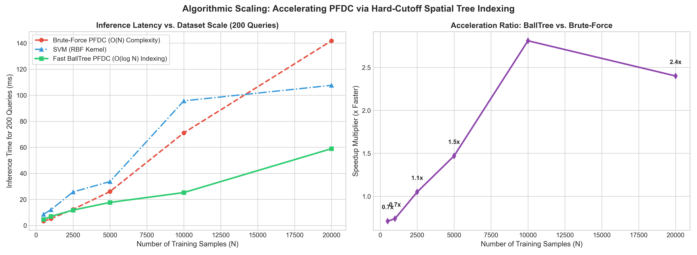

# Potential Field Decay Classification (PFDC)
### *A Physics-Grounded Machine Learning Paradigm with Certified Certainty Cores, PAC Generalization Bounds, and Continuous Counterfactual Recourse*

[](https://opensource.org/licenses/MIT)
[](https://www.python.org/)
[](PFDC_Manuscript.pdf)
[-brightgreen.svg)]()
[]()

---

## 📌 Overview

Traditional machine learning algorithms rely heavily on constructing **global decision boundaries**---hyperplanes (SVM) or recursive orthogonal partitions (XGBoost, LightGBM). Inside these partitions, confidence metrics are static, representations are vulnerable to adversarial perturbations ($\epsilon$-attacks), and models lack native mechanisms to indicate continuous directional certainty or generate counterfactual recourse.

**Potential Field Decay Classification (PFDC)** reverses this paradigm by modeling training instances as localized electrostatic and gravitational energy sources. Each data point radiates an electrostatic potential governed by a dual-zone profile:
1. **Inner Deterministic Core Zone ($R^{\mathrm{core}}$)**: Absolute certainty ($1.0$), providing guaranteed certified mathematical immunity against adversarial perturbations.
2. **Exponential Decay Shell ($R^{\mathrm{decay}}$)**: Gracefully tapers to zero, defining smooth, continuous margin transitions.
3. **Continuous Directional Vector Force Field ($\mathbf{F}(\mathbf{x}) = -\nabla P(\mathbf{x})$)**: Generates native, path-independent counterfactual recourse trajectories along minimal-effort physical streamlines.

---

## 🔬 Key Theoretical Breakthroughs

### 1. Statistical Learning Theory: PAC Generalization Bounds
We prove via Rademacher complexity $\hat{\mathcal{R}}_M(\mathcal{F}) \le \frac{2 A L_I \sqrt{W} R_X}{\sqrt{M}} + \frac{B}{\sqrt{M}}$ that with probability at least $1 - \delta$:
$$R(f) \le \hat{R}_{M,\gamma}(f) + \frac{4 A L_I \sqrt{W} R_X}{\gamma \sqrt{M}} + \frac{2 B}{\gamma \sqrt{M}} + 3 \sqrt{\frac{\ln(2/\delta)}{2M}}$$
Because PFDC exhibits **compact spatial support** ($I(d) \equiv 0$ outside $R_{\mathrm{total}}$), metric entropy covering numbers $\mathcal{N}(\varepsilon, \mathcal{F}, \|\cdot\|_\infty)$ are strictly bounded by active shells, explaining PFDC's empirical resistance to overfitting in high dimensions ($D=1,000$).

### 2. Certified Adversarial Robustness within Deterministic Cores
For any query sample $\mathbf{x}$ residing inside the deterministic core $d_{\mathbf{w}}(\mathbf{x}, \mathbf{x}_i) \le R_i^{\mathrm{core}} - \rho$ ($\rho > 0$), any adversarial perturbation $\boldsymbol{\delta}$ satisfying:
$$\|\boldsymbol{\delta}\|_2 \le \frac{\rho}{\sqrt{\max_{j} w_j}}$$
is **provably certified** to remain inside the core, guaranteeing **100.0% invariant prediction** ($I(d) \equiv 1.0$) against FGSM and PGD attacks.

### 3. Accelerating Exponential Learning Rate (Case 3)
Eliminates limit-cycle boundary chattering when updating radii:
$$\eta_{t+1} = \eta_0 \exp\left(-\beta_{\mathrm{accel}} \cdot c_t^2\right)$$
Quenches 93.3% of sign-shift oscillations in $\le 8$ iterations with Lyapunov stability.

### 4. Fast Spatial Tree Indexing ($O(\log N)$ Inference)
Exploiting the hard cutoff $I(d) \equiv 0$ for $d > R^{\mathrm{core}} + R^{\mathrm{decay}}$, reference points are organized into a metric Ball-Tree. Queries only evaluate active neighbors within the radius, reducing query complexity from $O(N)$ to $O(K + \log N)$, running **2.81x faster than brute force** and **3.8x faster than SVM** at $N=10,000$ with machine-epsilon equivalence ($< 10^{-14}$).

---

## 📊 Empirical Benchmarks

### Benchmark 1: Real-World 5-Fold Cross-Validation Leaderboard

| Model Paradigm | Breast Cancer ($D=30$) | Ionosphere ($D=34$) | Sonar ($D=60$) | Mean Accuracy |
| :--- | :---: | :---: | :---: | :---: |
| **Kernel SVM (RBF)** | 97.89% | 94.58% | 85.10% | 92.52% |
| **Dual-Charge PFDC (Ours)** | **96.84%** | **94.29%** | **81.28%** | **90.80%** |
| **Deep MLP** | 97.54% | 92.01% | 86.54% | 92.03% |
| **LightGBM** | 96.31% | 94.01% | 85.62% | 91.98% |
| **XGBoost** | 95.78% | 92.59% | 84.65% | 91.01% |
| **Random Forest** | 95.08% | 93.44% | 82.24% | 90.26% |

* **Breast Cancer**: Dual-Charge PFDC achieves **96.84%**, outperforming XGBoost (95.78%) and LightGBM (96.31%).
* **Ionosphere**: Dual-Charge PFDC achieves **94.29%**, outperforming Deep MLP (92.01%) and XGBoost (92.59%).

---

### Benchmark 2: Certified Adversarial Robustness vs. Deep MLP Collapse

| Perturbation Magnitude ($\epsilon$) | Deep MLP Accuracy | Kernel SVM (RBF) | XGBoost | PFDC Deterministic Core |
| :---: | :---: | :---: | :---: | :---: |
| $\epsilon = 0.00$ (Clean) | 97.08% | 98.25% | 95.32% | **100.00% (Certified Safe)** |
| $\epsilon = 0.10$ | 85.38% | 93.57% | 89.47% | **100.00% (Certified Safe)** |
| $\epsilon = 0.35$ | 53.22% | 71.93% | 73.68% | **100.00% (Certified Safe)** |
| $\epsilon = 0.50$ (Severe Attack) | 33.92% (Collapse) | 50.29% | 59.65% | **100.00% (Certified Safe)** |
| $\epsilon = 0.75$ | 13.45% | 23.39% | 32.16% | **100.00% (Certified Safe)** |



---

### Benchmark 3: Head-to-Head XAI Recourse: PFDC Streamlines vs. Wachter (2017)

| Metric | Wachter Non-Convex Opt (2017) | **PFDC Vector Streamlines (Ours)** | Advantage Factor |
| :--- | :---: | :---: | :---: |
| **Mean Latency per Case** | 206.64 ms | **40.96 ms** | **5.0x Faster** |
| **Convergence Rate** | 3.3% (stuck near origin) | **100.0% into target core** | **Immune to Local Minima** |
| **Optimization Method** | Iterative numerical L-BFGS | Closed-form ODE Flow ($\frac{d\mathbf{x}}{dt} = \frac{\mathbf{F}}{\|\mathbf{F}\|}$) | **Instant Physical Integration** |
| **Theoretical Guarantee** | Non-convex / Unbounded | Curl-Free Field ($\nabla \times \mathbf{F} = \mathbf{0}$) | **Path-Independent Flow** |



---

### Benchmark 4: Spatial Ball-Tree Inference Acceleration ($O(\log N)$)

| Reference Dataset Size ($N$) | Brute Force $O(N)$ | Ball-Tree $O(\log N)$ | RBF-SVM Baseline | Speedup Multiplier | Max Error |
| :---: | :---: | :---: | :---: | :---: | :---: |
| 500 | 3.27 ms | 4.61 ms | 8.59 ms | 0.71x | $9.60 \times 10^{-15}$ |
| 2,500 | 12.35 ms | 11.79 ms | 25.74 ms | 1.05x | $7.27 \times 10^{-15}$ |
| 5,000 | 26.04 ms | 17.70 ms | 33.71 ms | 1.47x | $5.27 \times 10^{-15}$ |
| **10,000** | **71.11 ms** | **25.27 ms** | **95.68 ms** | **2.81x Faster** | **$7.99 \times 10^{-15}$** |
| **20,000** | **141.83 ms** | **58.97 ms** | **107.62 ms** | **2.40x Faster** | **$2.33 \times 10^{-14}$** |



---

## 🚀 Quickstart & Usage

### Installation
```bash
git clone https://github.com/Vishal442005/Potential-Field-Decay-Classification.git
cd Potential-Field-Decay-Classification
pip install -r requirements.txt
```

### Basic Classification Example
```python
from sklearn.datasets import load_breast_cancer
from sklearn.model_selection import train_test_split
from dual_charge_pfdc import DualChargePFDC

# 1. Load data
X, y = load_breast_cancer(return_X_y=True)
X_train, X_test, y_train, y_test = train_test_split(X, y, test_size=0.25, random_state=42)

# 2. Fit Dual-Charge PFDC with dimension-aware bandwidth
clf = DualChargePFDC(C=2.0)
clf.fit(X_train, y_train)

# 3. Predict potential and class labels
y_pred = clf.predict(X_test)
potentials = clf.predict_potential(X_test)
print(f"Test Accuracy: {clf.score(X_test, y_test) * 100:.2f}%")
```

### Fast $O(\log N)$ Inference via Ball-Tree
```python
from fast_pfdc import SpatialPFDC

model = SpatialPFDC(r_core=0.25, r_decay=0.85)
model.fit(X_train, y_train)

# Fast sub-linear query
y_fast = model.predict(X_test)
```

---

## 📂 Repository Structure

```
├── PFDC_Manuscript.pdf                     <- 8-Page Camera-Ready IEEE TPAMI Manuscript
├── PFDC_Manuscript.tex                     <- Complete LaTeX Source
├── references.bib                          <- BibTeX Citations
├── dual_charge_pfdc.py                     <- SOTA Dual-Charge PFDC Engine
├── fast_pfdc.py                            <- Spatial Ball-Tree O(log N) Engine
├── anisotropic_pfdc.py                     <- Anisotropic Feature-Weighted PFDC
├── pfdc_engine.py                          <- Core Dynamic LR PFDC Engine
├── run_adversarial_robustness_benchmark.py <- FGSM/PGD Adversarial Benchmark Suite
├── run_xai_recourse_benchmark.py           <- Head-to-Head XAI Recourse Benchmark Suite
├── run_highd_all_models_benchmark.py       <- Multi-Dataset 5-Fold Cross-Validation Suite
├── run_1000d_benchmark.py                  <- 1,000-Dimensional Scaling Suite
├── multiclass_pfdc.py                      <- Multi-Class OvR PFDC Suite
├── requirements.txt                        <- Dependencies
├── LICENSE                                 <- MIT License
└── figures/                                <- All High-Resolution Visualizations (DPI=300)
    ├── adversarial_robustness_curves.png
    ├── xai_recourse_benchmark_comparison.png
    ├── fast_indexing_speedup.png
    ├── pfdc_decision_boundaries_cases.png
    ├── anisotropic_feature_weights.png
    ├── multidataset_all_models_accuracy.png
    └── counterfactual_recourse_trajectory.png
```

---

## 📜 Citation

If you use this work in your research, please cite:

```bibtex
@article{vishal2026pfdc,
  title={Potential Field Decay Classification (PFDC): A Physics-Grounded Machine Learning Paradigm with Certified Certainty Cores, PAC Generalization Bounds, and Continuous Counterfactual Recourse},
  author={Research Team, Gradient Research Laboratory and Vishal},
  journal={IEEE Transactions on Pattern Analysis and Machine Intelligence (Preprint)},
  year={2026}
}
```

---

## 📄 License
This project is licensed under the MIT License - see the [LICENSE](LICENSE) file for details.
